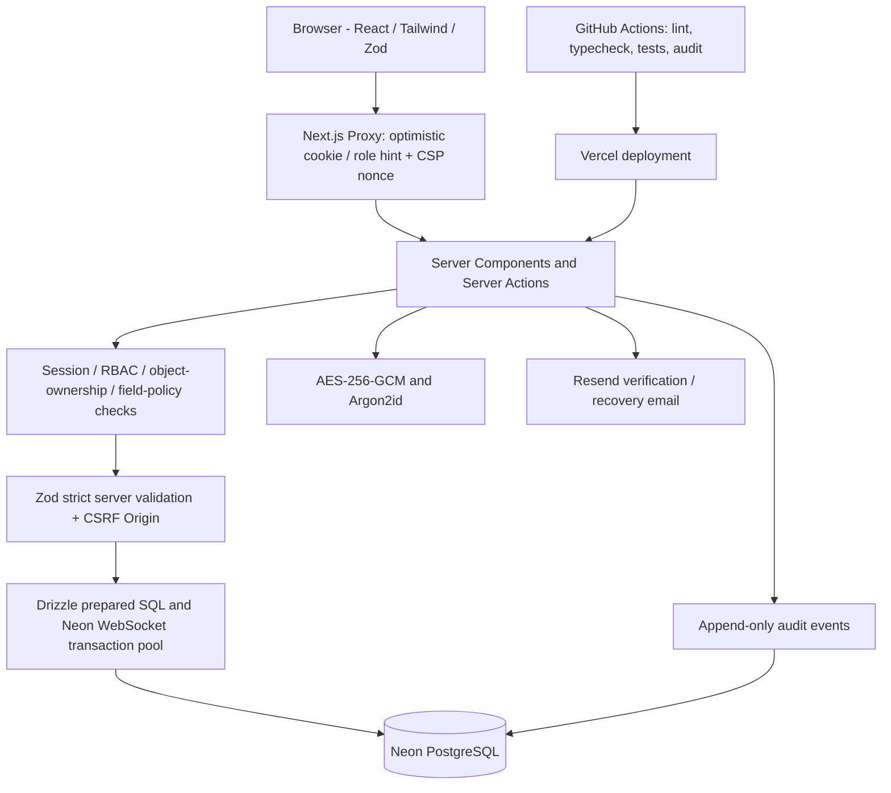
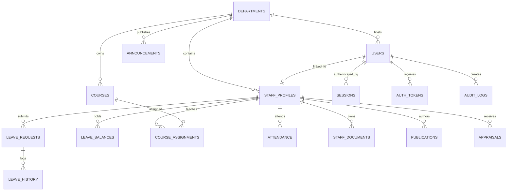

# Departmental Staff Management System (DSMS)

**University semi-project:** Building Web Applications: Web Application Security, Testing, Deployment and Review.

A role-aware Next.js + TypeScript application for a university department, with Drizzle ORM and Neon PostgreSQL. This project contains source code, SQL migrations, a fictional dataset generator, security and browser tests, deployment configuration, and public `/security`, `/testing`, `/review` demonstration pages.

> **Verification disclosure (16 November 2026):** The repository was generated in an environment with no npm registry DNS access. TypeScript/TSX source files were syntax-parsed (71 files, 0 parse errors). Six limited Node.js smoke checks were **executed and passed** against transpiled production security/business-rule helpers; these are not Vitest, database, browser or build tests. The Next.js build, ESLint, TypeScript type checking against installed libraries, Vitest, Playwright, npm audit, database migrations and Lighthouse were **not executed**. The Testing page distinguishes those six executed smoke checks from all unrun cases. **Do not deploy for real staff data until installation, test, security and operational checks succeed.** The Neon project and its `production`, `development`, `test` branches have been created, but not migrated or seeded.

## Stack

- Next.js 16 App Router, React 19, TypeScript and Tailwind CSS 4
- Neon serverless PostgreSQL, Drizzle ORM, `@neondatabase/serverless` (WebSocket Pool for interactive transactions)
- Zod 4 with strict shared schemas; Argon2id; Node AES-256-GCM; keyed SHA-256 token hashes
- Vitest unit/integration, Playwright Chromium E2E (desktop, iPhone-sized and Android-sized viewports)
- GitHub Actions, Vercel hosting, Resend delivery for transactional email

## Roles and permissions

| Capability | STAFF | HOD | ADMIN |
|---|---|---|---|
| Search colleague directory | Public fields | Same-department public and permitted restricted fields | Same-department full authorized profile |
| Edit profile | Own only | Own only | Own + administrative record fields |
| Course list/assignments | Own allocations | View/add/assign department | View/add/assign department |
| Leave | Request/view own | Request own; decide **others'** requests | Record decisions, not HOD approval |
| Attendance | Own | Department read | Department read/write |
| Documents | Add/view own | Department view/verify | Department view/verify |
| Achievements | Add/view own | Department view and CSV | Department view and CSV |
| Appraisals | View own | Read/create **others'** | Read department, not create |
| Reports | No | Department-only | Department-only |
| Account activation, roles, archive, audit view | No | No | Yes |

The proxy is an optimistic navigation gate; server and object/data-query checks provide the real authority.

## First-time installation

Requirements: Node.js 22+, npm, a Neon account, a verified Resend sending domain (for registration email), and optional Vercel/GitHub accounts.

```bash
npm install
cp .env.example .env.local
node -e "const c=require('crypto');console.log(c.randomBytes(32).toString('base64'))"
# Generate a SECOND independent 32-byte secret, and configure all variables.
# On the isolated development branch:
npm run db:migrate
npm run db:seed
npm run dev
```

Visit `http://localhost:3000`. In `.env.local`, use the **development branch's** pooled URL for `DATABASE_URL`, direct URL for `DATABASE_URL_UNPOOLED`, separate 32-byte-base64 `SESSION_SECRET` (43+ chars) and `FIELD_ENCRYPTION_KEY`, and `APP_URL=http://localhost:3000`. Set `ALLOWED_URL_HOSTS`, `RESEND_API_KEY`, `MAIL_FROM`, and the three `SEED_*_PASSWORD` variables. Seed passwords must meet the Zod policy (12+ chars; upper/lower case, digit, symbol, no common password phrases). Never commit `.env.local` or seeded passwords. All seeded accounts have `force_password_change=true` on first sign in.

For local development **without** an email provider, previously seeded accounts may sign in and exercise the app; self-registration and password recovery require a configured delivery provider. `E2E_MODE=true` is reserved for a disposable non-production test environment; it suppresses outbound mail but does not mark accounts verified or approved.

**Demonstration identities (fake):** `admin@example.edu`, `hod@example.edu`, `staff01@example.edu` through `staff25@example.edu`. Passwords are the values **you set** in environment variables; none are included in source. Seed creates 1 ADMIN, 1 HOD, 25 STAFF accounts, 27 linked records, 20 courses, example assignments, leave, appraisals, attendance, achievements and announcements.

## Commands

| Command | Effect |
|---|---|
| `npm run dev` | Local Next.js server |
| `npm run build` / `npm start` | Production build/server |
| `npm run lint` / `npm run typecheck` | Static checks |
| `npm run db:migrate` | Apply checked-in `drizzle/0000_initial.sql` to the *direct* branch connection |
| `npm run db:seed` | Idempotent fictional sample records (refuses `NODE_ENV=production`) |
| `npm run test:smoke` | Runs six dependency-free Node smoke assertions on production helpers; NOT a substitute for Vitest |
| `npm run test:unit` | Vitest unit suite |
| `npm run test:integration` | Dedicated Neon test branch only; requires `INTEGRATION_TESTS_ACK=YES` |
| `npm run test:e2e` | Playwright desktop and mobile-sized Chromium runs |
| `npm run test:report` | Parse **actual** Vitest/Playwright JSON artifacts into `test-results/latest.json` |
| `npm run audit` | Audit high/critical npm advisories; requires installed packages/lockfile |
| `npx tsx scripts/rotate-key.ts` | Re-encrypt sensitive fields using old/new keys in a transaction |

A manually reviewed `drizzle/0000_initial.down.sql` is supplied for **disposable branches only**, not an automatic production rollback. If adding new migrations, generate and **verify a Drizzle snapshot** against the baseline before using `db:generate`; this handcrafted initial SQL does not include a generated Drizzle snapshot. The `db:generate` command is provided for use after the baseline is normalized with Drizzle Kit. Migration rollback in production is a separate, restore-first decision.

## Application architecture



## Entity relationship diagram



## Key routes

| Group | Pages |
|---|---|
| Public | `/`, `/register`, `/login`, `/forgot`, `/reset`, `/verify`, `/security`, `/testing`, `/review` |
| Signed in | `/dashboard`, `/profile`, `/staff`, `/staff/[id]`, `/courses`, `/leave`, `/attendance`, `/documents`, `/publications`, `/appraisals`, `/announcements`, `/change-password` |
| Managers | `/reports`, `/api/reports/[kind]` |
| Admin | `/admin` |
| API | `GET /api/health`, `GET /api/session/csrf`, `POST /api/session/logout` |

## Code organization

```text
src/
  actions/          Auth, staff and departmental operation server actions
  app/              Public and role-protected Next.js App Router pages and APIs
  components/       Responsive navigation, forms, tables and button controls
  db/               Drizzle schema and Neon connection
  lib/              Auth/session, Zod, crypto, RBAC, CSV, business rules
  proxy.ts          Nonce CSP, security headers and optimistic route checks
  instrumentation.ts  Startup environment validation
scripts/            Seed, E2E bootstrap, test result collector, key rotation
drizzle/            Baseline SQL migration, reversal and journal
 tests/             Vitest unit/integration + Playwright E2E
.github/workflows/  CI quality gate, test branch, production deploy
```

## Operational documents

- [SECURITY.md](SECURITY.md) — threat model, controls, OWASP mapping and key management
- [TESTING.md](TESTING.md) — executable test inventory, honest run status, checklists
- [DEPLOYMENT.md](DEPLOYMENT.md) — real Neon branch setup, Vercel, GitHub Actions, monitoring, recovery and rollback
- [REVIEW.md](REVIEW.md) — project review, evidence, observed constraints and roadmap

**Important design limitations:** single-department onboarding picks the first configured department; create additional tenant-aware onboarding before supporting multiple departments. External documents are allowlisted references rather than secure binary uploads. Non-annual leave entitlement policies are not modeled in depth. HOD leave requires a second authorized HOD or separate governance procedure. Sample data and app are for evaluation, **not** real staff PII prior to independent security verification.
